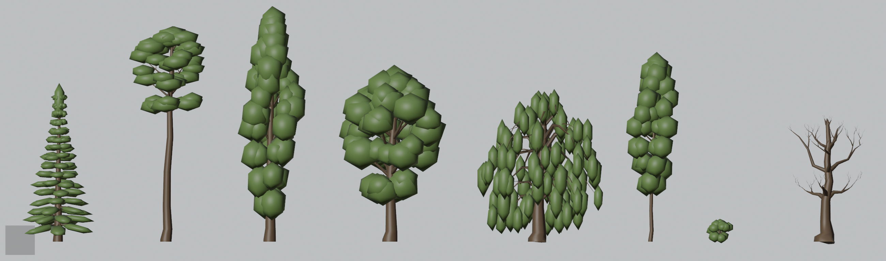

# MiskoDizaineris

[Русский](README.ru.md) | **English**

A Blender 5.2+ add-on for procedural low-poly trees: a bent trunk, branches that fork, and foliage. The UV unwrap is made when the tree is created.
It is built like RoadBuilder: `generator.py` (geometry, bmesh), `operators.py` (settings and operators), `ui.py` (panel),
`exporter.py` (FBX and presets).

Panel: **3D View → N → MiskoDizaineris**. Also **Add → Mesh → Tree**.

How to install and work: [docs/HOWTO.md](docs/HOWTO.md). Version history: [CHANGELOG.md](CHANGELOG.md) (in Russian). Ready-made zip: [Releases](https://github.com/Ivanou-Dzmitry/misko_dizaineris/releases).

## Types

Left to right: spruce, pine, poplar, linden, willow, birch, bush, bare tree. A type button adds a tree at the 3D cursor and puts the settings of the type into the panel.

| Type      | What it is |
|-----------|------------|
| Spruce    | A straight trunk and tiers (skirts) with a toothed hem (`Foliage` = Tiers, about 700 triangles); with `Foliage` = Sheath or None it is herringbone branches again. |
| Pine      | A tall bare trunk with a small crown on top. |
| Poplar    | Tall, a narrow spindle-shaped crown, branches steeply up. |
| Linden    | A short trunk and a wide round crown. |
| Willow    | A thick trunk, a wide crown, long hanging branches. |
| Birch     | Slim, slightly bent, an oval crown. |
| Bush      | No trunk, thin stems fanning out from the ground. |
| Bare Tree | A bare (winter, dry) tree: a flared crooked trunk, thick broken branches, many forks, no foliage. |

## How a tree is defined

**Trunk**: `Height`, `Width at Base`, `Width in Middle`, `Width at End` (radii at 0, 50% and 100% of the height, straight between them),
`Stubs`, `Stubs Start` (where on the bare trunk they begin), `Stub Length` (short stubs on the bare trunk below the crown, like a pine), sides, rings, `Bend` (lean of the top), `Wobble`, `Sink` (how deep the trunk goes into the ground), `Bottom Cap`.

**Crown**: a silhouette in three levels, like in a sketch:

1. `Crown Bottom`: where the lowest branches grow (a part of the height), `Radius 1`: how far they reach from the trunk.
2. `Widest Place`: where the crown is the widest (a part of the crown), `Radius 2`.
3. `Crown Top`: where the top branches grow, `Radius 3`.

`Roundness`: 0 is straight lines (a cone), 1 is an ellipse (a ball). Spruce: the widest place at the bottom (0), `Radius 3` = 0.

**Branches**: `Levels` rows of `Per Level` branches (1 per row is a spiral, 4–6 are whorls), `Angle Bottom` / `Angle Top` from the trunk,
`Droop` (sag, minus is up), `Thickness` (a part of the trunk thickness at that height), `Tip Thickness`, `Branch Sides`, `Branch Segments`.
**Bend**: the trunk is not a straight pipe. `Bend` (lean of the top) and `Wobble` (every ring is shifted from the one below to a random side: curves and kinks), `Flare` (wider at the base).
Branches: `Wiggle` (a bend to the side and a kink at every inner ring; needs `Branch Segments` from 3).

`Collar`: where a branch leaves the trunk it is wider, by up to this part, and narrows to its own thickness: the join does not look like a thin tube cut into a thick one. The collar is never wider than the trunk. `Thickness` sets the thickness with no lower limit: at the minimum the branches are as thin as wire.

**Bush** (`Foliage` = Bush Blob, type Bush): `Bush Shape` (Ball, Box, Egg), `Bush Width` and `Bush Length` (size in metres), `Bush Blobs` (1–4 round blobs, Ball only: the biggest in the middle, the others round it), `Bush Cloud` (with one blob: a ball with puffs), `Bush Rough`, `Bush Lift`, `Bush Stems`, `Roots Radius`, `Stem Lean`.

**Forks** (`Forks`): on every branch grow branches in the shape of a Y, up and to the sides, and they fork too: `Fork Levels` generations. `Fork Start` (where the first one is, a part of the branch length),
`Fork Angle`, `Fork Length` (a part of the branch length), `Fork Thickness`. 0 = plain sticks.
`Pattern`: `Alternate` (one at a time, first on one side, then on the other: broadleaf trees) or `Pairs` (two opposite forks at every place, to the sides and forward, a herringbone like a spruce branch; `Forks` is the number of pairs; the default for spruce).

**The smaller the branch, the less detail**: the size of a branch is the crown radius where it grows. At the bottom and top edges of the crown (small `Radius 1` and `Radius 3`) the branches are simple: fewer forks, generations, sides and segments. `Forks` and `Fork Levels` are the values for the biggest branches; `Fork Fade`: 0 = the same for all, 1 = in proportion to the radius. The top `Fork Top Skip` rows (2 by default) have no forks. Forks on a branch get shorter towards the end: the first is the longest, the one at the tip is the shortest. A branch is shortened until its end is inside the crown silhouette, so the top of the crown is round.

**Foliage** (`Foliage`): `Clumps` is a clump at the end of every branch and fork, `Sheath` is a flat skirt along the branch (spruce), `None` is no foliage.
`Leaf Size`, `Leaf Height` (below 1 is a flat clump, above 1 is stretched: willow, poplar), `Leaf Detail` (1 = 20 triangles per clump), `Spread` (clumps are scattered: not only at the tips, moved to the sides), `Foliage` = **Tiers** (a spruce in tiers: no branches are built, tiers with a toothed hem, `Tier Lobes` (wide lobes), `Tier Cut Width` and `Tier Notch` (straight cuts between them: a circle with cuts from above), `Tier Bend` (the side profile of a lobe is bent: steeper at the trunk, flatter at the edge), `Tier Height`, `Tier Thickness` (a rim along the hem, like Solidify Only Rim with no bottom), `Tier Layers`; the default for Spruce), `Puffs` (small puffs on a clump: a fluffy cloud), `Size Variation` and `Size Falloff` (clumps of different sizes, big ones in the middle of the crown), `Merge Leaves` (hidden geometry is not made: clumps with the same centres or inside others, and faces inside the balls).

A row of branches is a base line: every branch leaves a little above or below it (`Height Spread`). The thickness of a branch where it leaves is a part (`Thickness`) of the trunk radius at that height, but always less than the trunk, and thinner the more branches there are in a row.

`Seed` and `Randomness` make trees of one type different. A tree is never taller than `Height`: branches that would go higher are shortened.

## A tree as a group

A tree is an **Empty** (the root: it holds the settings and stamps, you move and rotate it) with separate objects under it:

- `<name>_trunk`: the trunk, material `FT_Bark`;
- `<name>_branches`: branches and forks, the same material `FT_Bark`;
- `<name>_leaves`: the foliage, material `FT_Leaf` (absent if `Foliage` = None).

Selecting any part selects the whole tree for rebuilding. The FBX export keeps the hierarchy.

## Live Update

Any parameter of the panel **rebuilds the selected trees at once**: drag a slider and watch (a rebuild takes 6–18 ms). Select a tree (or any part of it).
If nothing is selected, nothing changes. **Get Settings** takes the settings of the active tree into the panel. For a heavy tree you can turn `Live Update` off and
press **Rebuild Selected**. Everything is smooth-shaded (`Smooth Shading`, can be turned off).

## UV

**One shared 0..1 map for the whole tree** (trunk, branches, foliage), the same density, islands are not rotated, everything strictly inside 0..1. The islands are packed into the smallest square (skyline). Options in the UV section:

- **Unique UV (Bake)** (on by default): for baking AO and normals nothing overlaps. Every branch and fork is its own strip, every foliage ball (the main one and the puffs) is unwrapped into its own island. Off: for a tiling texture similar islands lie in a stack (`Overlap Similar`, like in ConstructionBuilder), and all the foliage is on one shared square (baking would mix the clumps).
- **Straight Strips** (on): a strip of one width along its whole length, no dead corners; the texture is stretched where the tube is thin.
- **Cut Trunk**: a tall trunk is cut across into pieces (0 = as much as needed to make the tile smaller, 1 = do not cut).
- **Overlap Similar** (only with Unique UV off), **UV Margin** (the gap).

The parts stay separate objects with two materials: `FT_Bark` (trunk and branches) and `FT_Leaf` (foliage); their UV is shared: one atlas.

## Buttons

- **Add** (per type) — a tree at the 3D cursor.
- **Add Variants** — a row of trees of the current type with seed, seed+1, …
- **All Types** — one tree of every type in a row, to compare.
- **Rebuild Selected** — rebuild the selected trees with the panel settings (with `Live Update` this happens by itself). **Get Settings** — take the settings of the active tree into the panel.
- **Export FBX** — the selected trees (or all), one file per tree or one file for all. For Unity: scale and axes are baked into the mesh. `Merge Trunk and Branches` (default): the trunk and branches go into the file as one mesh `<name>_wood` (material `FT_Bark`), the foliage as a separate `<name>_leaves` (`FT_Leaf`): two meshes, two materials; in the scene the parts stay separate.
- **Presets** — save the panel settings under a name and load them. The folder button opens the presets folder (`%APPDATA%\Blender Foundation\Blender\<version>\extensions\.user\user_default\misko_dizaineris\presets`, one JSON per preset), the circle button re-reads the files.

The root of every tree keeps `forest_type`, `forest_params` (JSON) and `forest_version`. The name is `<type><height>_s<seed>`, for example `spruce10_s1`.

## What next

Foliage cards with alpha as a second style, a split of the trunk itself (several leaders), roots, LOD.

## Build

`build.ps1` builds `dist/misko_dizaineris.zip` for installing through Extensions.
